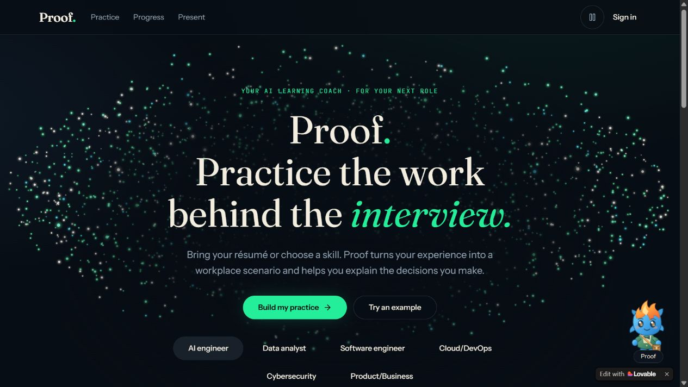
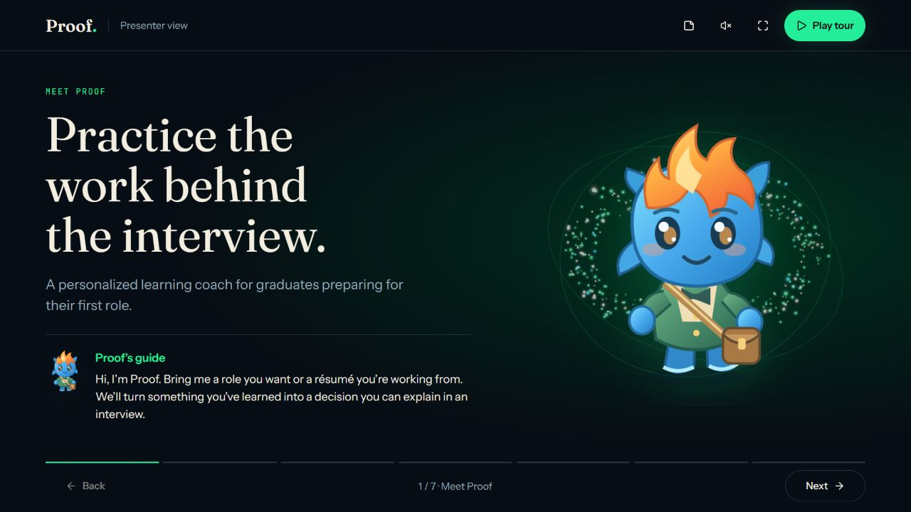

# Proof Learning Coach

**An AI-powered career practice studio that turns a learner's goals into workplace decisions.** Built for UTD's Biggest No-Code Hackathon and developed further with direct engineering, Proof combines personalized LLM generation, structured feedback, interactive scenarios, and a conversational companion.

[Try the live app](https://proof-learning-coach.lovable.app) · [Watch the guided product tour](https://proof-learning-coach.lovable.app/present) · [Start a practice](https://proof-learning-coach.lovable.app/practice?new=true)



The guided presentation introduces the learning loop and lets visitors try a prepared decision:



## Why this project stands out

Proof connects a learner's background to a concrete workplace decision. Instead of stopping at a generated answer, the experience asks the learner to make a choice, explain their reasoning, review feedback, and revisit the idea in a changed situation. An animated companion makes contextual help available throughout the experience.

The engineering challenge is making that experience dependable around a probabilistic model. Proof treats generated content as data, validates its structure, checks résumé evidence against the excerpt, bounds requests, and gives learners control over what they submit and apply. The prepared tour and fixed examples offer a clear way to explore the product when live AI is unavailable.

## Engineering highlights

- **Personalized LLM workflows:** generate workplace scenarios, contextual coaching, résumé suggestions, and feedback using Ollama's chat API and schema-validated JSON.
- **Human control and grounding:** résumé text is reviewed before submission; suggested evidence is checked against the supplied excerpt and the learner confirms the practice direction.
- **Reliable AI boundaries:** Zod contracts, bounded inputs and outputs, session capabilities, atomic usage budgets, server-side provider secrets, and retry paths protect the application around model calls.
- **Interactive learning:** learners commit to decisions, inspect consequences, explain tradeoffs, revise responses, and apply their reasoning to a changed constraint.
- **Product engineering:** responsive React interfaces, accessible components, reduced-motion support, canvas particle physics, and a character with animated states.
- **Verification:** 109 frontend tests across 20 files passed in the November 2026 release, alongside TypeScript checks and backend fixture tests. These checks do not measure learning outcomes.

## Technology and workflow

| Area | Technologies and methods |
| --- | --- |
| AI engineering | Ollama API, Gemma model, prompt design, structured JSON generation, Zod validation, contextual tutoring and feedback |
| Frontend | React 19, TypeScript, TanStack Start and Router, Vite, Tailwind CSS, Radix UI, Motion, Canvas and SVG |
| Backend | Supabase Edge Functions, Deno, PostgreSQL, Supabase Auth, row-level security, server-side secrets |
| Document processing | PDF.js, fflate, browser-side PDF/DOCX/TXT extraction |
| Quality | Vitest, Testing Library, TypeScript, ESLint, browser and responsive testing |
| Delivery | Git, GitHub, Lovable hosting, Supabase deployment |
| Development workflow | Codex with Lovable, Supabase, GitHub and Figma MCP connections for development and investigation |

The MCP connections supported the development workflow; the application does not expose an MCP server or implement an autonomous agent. It calls an existing model for inference and does not train or fine-tune one.

## Architecture

```text
Browser: learner profile + reviewed résumé + practice decisions
    ↓ explicit requests
Supabase Edge Function: validation, session checks and usage budgets
    ↓ structured chat request
Ollama API: scenario, tutor, feedback or résumé suggestions
    ↓ validated response
Browser: interactive scene, explanation, feedback and local progress
```

Career progress is stored in the browser; the original data investigation has a separate account-backed sync. The model provider key remains in server-side configuration.

Proof does not claim to measure job readiness or guarantee employment. It was built for [UTD's Biggest No-Code Hackathon](https://aibizclub.org/utds-biggest-no-code-problem-statement).

## Experience

Learners can start with an optional PDF, DOCX, TXT or pasted résumé. The browser extracts an editable excerpt. Explicit AI analysis sends that excerpt through Supabase to Ollama and returns role and skill suggestions with supporting quotations. Only the confirmed practice focus is added to the learning profile.

Proof, the floating comet companion, offers contextual chat, responds to practice feedback and sleeps after one minute of inactivity. The Present link opens a seven-chapter prepared tour with a sample decision, speaker notes, manual or timed playback, and optional browser narration when voices are available.

Six starting directions cover AI engineering, data analysis, software engineering, cloud/DevOps, cybersecurity, and product/business. Learners can enter their own topic. AI generation uses the complete learning profile; fixed examples use only the selected topic and are clearly labeled as non-AI exercises.

The dark interface includes centered interactive canvas particles, scroll-driven storytelling, motion-aware page transitions, an introductory practice studio, and six bounded scene compositions. Generated scenes are validated data, not executable code. Decision consequences appear after the learner commits, and every recorded decision can be inspected separately.

The original deterministic revenue investigation remains available at `/learn`, with its existing evidence, instructor sample, account integration, and data tests.

## Development

Use the committed Bun lockfile for reproducible dependencies:

```sh
bun install --frozen-lockfile
bun run dev
bun run test
bunx tsc --noEmit
bun run build
```

The frontend uses React, TypeScript, TanStack Start, Tailwind, Motion, and accessible Radix components. Source rules are in `AGENTS.md`. Lovable hosting and its Git connection are configured separately.

## AI and persistence

The external Supabase project runs the separate `career-coach` function. It validates caller ownership, stores scenarios and bounded conversation context privately, applies atomic inference budgets, and calls the configured Ollama provider. Provider credentials stay server-side. See `supabase/VERIFICATION.md` for deployed source details, security checks, and known limits.

Career practice saves in the current browser. Signing in does not currently sync career history across devices. The original sample-case account sync is separate. Guest capabilities are private session credentials: never put them in URLs, logs, analytics, screenshots, or exports.

Generated output can be inaccurate or fail schema validation. Failures keep the learner's inputs and offer retry or an explicitly unevaluated continuation; fixed examples remain available. Software checks are not evidence of learning gains. A learner study is still future work.
